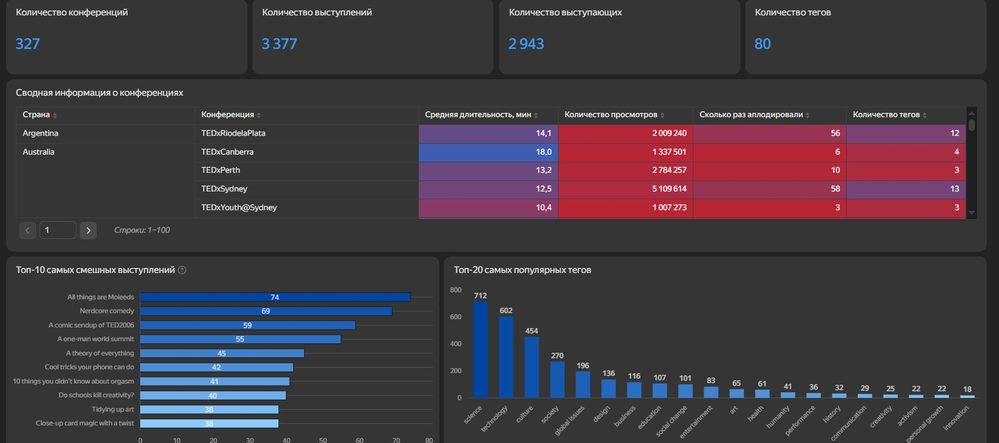
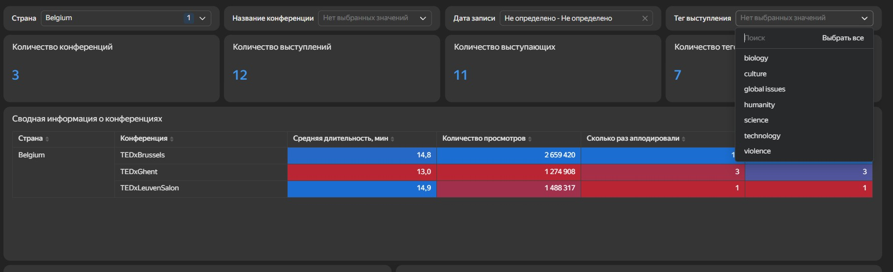

# Аналитика конференций TED (Yandex DataLens)

Бизнес-задача: создать интерактивный дашборд для мониторинга ключевых показателей - страна проведения, темы, спикеры и реакция зрителей.

## Основные блоки дашборда:
* Вкладки, позволяющие понять объем данных: количество конференций, количество выступлений, уникальное количество выступающих, количество тегов.
* Сводная информация о конференциях: страна, средняя длительность выступления, максимальное количество просмотров, которое было у выступления, сколько раз аплодировали за всю конференцию, количество тегов.
* Топ-10 самых смешных выступлений.
* Топ-20 самых популярных тегов.
* Селекторы по стране, названию конференции, тегу выступления и дате записи для возможности более точечно и детально изучить информацию.

## 📌 Ключевые выводы:
1. Самые популярные темы: science, technology, culture.
2. Среднее количество выступающих на конференции - 10 спикеров.
3. Выступления в среднем длятся 15 мин.
4. Самыми популярными и интересными зрителям спикерами являются Sir Ken Robinson - автор, педагог; Amy Cuddy - социальный психолог; Tim Urban - блогер, писатель. Они в своих выступлениях объединяют серьезные темы (образование, психология) с юмором и эмоциональной вовлеченностью.
